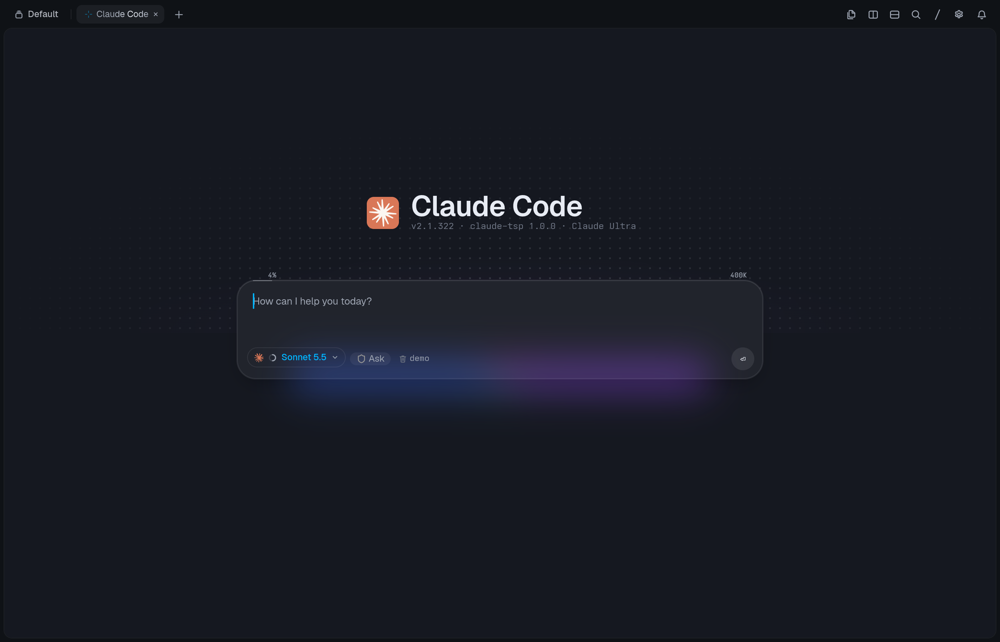
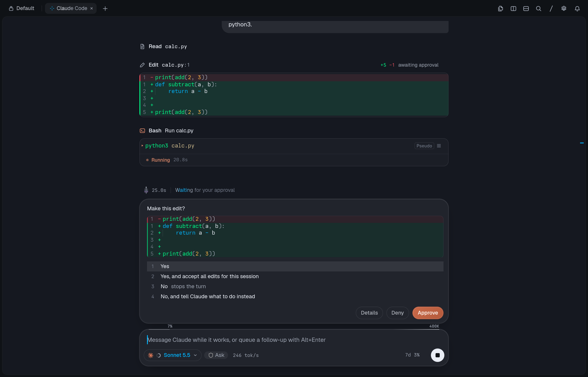
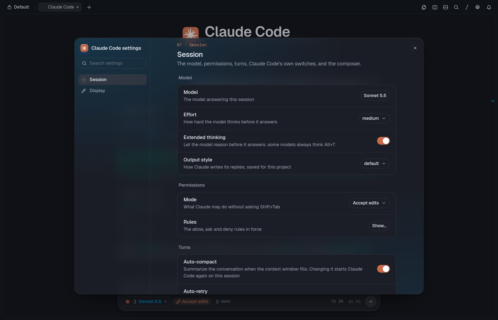

<p align="center">
  
</p>

<h1 align="center">claude-tsp</h1>

<h3 align="center">Claude Code, rendered native in Tern.</h3>

<p align="center">
  A real surface for Claude Code: semantic markdown, tool cards, diffs,
  subagents, approvals, plans, model and effort pickers, session management,
  plugin widgets, and a composer that belongs in Tern.<br>
  No ANSI mirror. No patched Claude Code. Stock <code>claude</code> outside Tern.
</p>

<p align="center">
  
  
  
  
</p>

<p align="center">
  
</p>

---

| A turn: read, edit with a diff, run | Approval, with the request's own choices |
|---|---|
|  |  |

| Models | Settings | Light |
|---|---|---|
|  |  |  |

Light and dark follow Tern, as do its themes; the clay accent is Claude's own
and `/theme` hands the accent back to Tern's.

It is a front end, not a fork. `claude-tsp` starts the Claude Code you already
have and talks to it over its stream-json protocol (`claude -p --input-format
stream-json --output-format stream-json`, the channel the Agent SDK uses), so
models, permissions, sessions, skills, plugins, hooks and MCP servers are all
Claude Code's own. Sessions are shared with the terminal UI: anything started
here resumes there, and the other way round.

Two commands:

- `claude-tsp` fronts the `claude` on your `PATH` with your normal config.
- `claude-pi-tsp` fronts the claude-pi toolkit, if you have it installed: its private
  binary, sparse system prompt, tool set and `pi-harness` plugin, so the local
  model and the ChatGPT-subscription models appear in the model picker with
  their own names and logos.

Outside Tern, and for every non-interactive invocation (`-p`, `--version`,
`mcp …`, `plugin …`), both are the stock program with the arguments unchanged.

## Install

```sh
npm install        # builds dist/
ln -sf "$PWD/bin/claude-tsp" ~/.local/bin/claude-tsp
ln -sf "$PWD/bin/claude-pi-tsp" ~/.local/bin/claude-pi-tsp
```

Node 22.19 or newer, Tern 0.9.20 or newer, Claude Code 2.1.300 or newer.

## Use

Every Claude Code flag passes through: `claude-tsp --model opus`,
`claude-tsp --continue`, `claude-tsp --resume` (opens the picker),
`claude-tsp --permission-mode plan "plan the refactor"`.

| Key | Does |
|---|---|
| Enter | Send. While Claude works, the message is taken at its next step |
| Alt+Enter | Queue for after the current turn; Alt+↑ brings queued messages back |
| Shift+Enter, `\` Enter | New line |
| Esc | Stop Claude (or a running `!command`); twice on an empty draft opens rewind |
| Shift+Tab | Step the permission mode: Ask, Accept edits, Plan, Auto |
| Alt+P | Switch model; Alt+T turns thinking on or off; Alt+E steps the effort |
| Ctrl+B | Send the running command or subagent to the background |
| Ctrl+T, Ctrl+O | Show or hide the task list; expand every block |
| Ctrl+R, Ctrl+S | Search prompt history; set the draft aside |
| `/`, `@`, `!` | Commands and skills, files, shell (`!!` keeps the output from Claude) |
| Tab | Take the suggested next prompt |

`/help` lists the rest. Keys are rebound in
`~/.local/state/claude-tsp/keybindings.json` (`{"app.model.select": "ctrl+l"}`).

### Commands

Drawn natively: `/model`, `/effort`, `/mode`, `/plan`, `/resume`, `/continue`,
`/clear`, `/rewind`, `/fork`, `/tree`, `/branch`, `/context`, `/usage`, `/status`,
`/cost`, `/rename`, `/agents`, `/tasks`, `/todos`, `/mcp`, `/permissions`, `/btw`, `/thinking`, `/login`, `/logout`, `/doctor`, `/hooks`, `/memory`, `/plugin`, `/statusline`, `/trace`, `/keybindings`, `/ide`,
`/skills`, `/output-style`, `/add-dir`, `/outline`, `/copy`, `/export`,
`/inspect`, `/attach`, `/retry`, `/config`, `/vim`, `/theme`, `/help`.

Run by Claude Code itself, with their output in the transcript: `/compact`,
`/init`, `/goal`, `/review`, every skill, and every plugin command.

Almost nothing needs Claude Code's own terminal UI (five commands still open
it: `/autofix-pr`, `/passes`, `/powerup`, `/remote-env`, `/voice`). Its wizards and dialogs
(`/install-github-app`, `/sandbox`, `/remote-control`, `/feedback`, `/stats`,
`/release-notes`, the plugin marketplace, permission rules) are drawn here.
`/tui [command]` still hands this pane to it on the same session, and takes it
back when it exits.

`/remote-control` and `/feedback` are in `claude-tsp` only: they need Claude
Code's non-essential traffic, which claude-pi's settings switch off.

Plugins that draw (`$.ui`) are drawn too: their band sits above the composer,
their panes open as sheets, and `/widgets` reaches their buttons by keyboard.

## Look

The surface follows Tern's theme, light or dark, including custom themes. Its
own identity is Claude's clay as the accent color, the spark mark, and the
permission-mode pill. `/theme` (or Settings → Display → Claude accent) switches
the clay off, and the Tern theme's own accent is used instead.

## Environment

| Variable | Effect |
|---|---|
| `CLAUDE_TSP_BIN` | The Claude Code binary to front (default: `claude` on `PATH`) |
| `CLAUDE_CONFIG_DIR` | Claude Code's config directory, as for `claude` itself |
| `CLAUDE_TSP_HOME` | Where prompt history, display choices and key bindings are kept (default `~/.local/state/claude-tsp`) |
| `CLAUDE_TSP_STOCK=1` | Always run stock Claude Code |
| `CLAUDE_TSP_NOTIFICATIONS=0` | No desktop notification when a turn ends or an approval waits in a hidden pane |
| `CLAUDE_TSP_RECORD=file`, `CLAUDE_TSP_TRACE=file` | Record the TSP traffic; log TSP errors |
| `CLAUDE_TSP_CSS=file` | A stylesheet to try in place of the built-in one |

## Develop

```sh
npm test                                  # build + 65 tests
tools/verify.sh                           # 156 end-to-end checks in headless Tern (about 40 minutes)
tools/serve.sh start a /tmp/demo "$PWD/bin/claude-tsp"   # headless Tern
tools/say.sh a "hello" 6 shot-name        # type, send, wait, screenshot
tools/serve.sh stop a
```

`docs/PROTOCOL.md` describes the Claude Code side; `docs/OMP-ROWS.md` goes
through omp's inventory row by row; `docs/PARITY.md` lists every
feature against Claude Code's terminal UI, claude-pi, omp's and pi-tsp's
surfaces, with what is not covered.

## Credits

claude-tsp exists to bring more programs to Tern's Surface Protocol. It builds
on other people's work and is not affiliated with any of them:

- [Claude Code](https://claude.com/claude-code) by Anthropic — the agent, and
  the stream-json protocol this surface drives. Claude Code is not patched or
  redistributed here; you install it yourself. The GitHub Actions workflow
  files that `/install-github-app` writes are the ones Claude Code ships.
- [Tern](https://stencil.so/tern) by Stencil Labs — the terminal and the Tern
  Surface Protocol (TSP), and the `@stencil-hq/tern` SDK this is written on.
- [oh-my-pi](https://github.com/can1357/oh-my-pi) — the reference TSP client.
  Its surface set the bar: `docs/OMP-ROWS.md` goes through its 104 behaviours
  one by one, and this surface keeps its node roles so Tern styles both alike.
- [claude-pi](https://github.com/CompactionHater/claude-pi) by CompactionHater —
  the idea and the specification of a pi-style Claude Code (sparse prompt, lean
  tool set, local and routed models). This repository contains none of
  claude-pi's code. `claude-pi-tsp` fronts an install built from the spec (its
  own launcher, binary and `~/.claude-pi`); the plugins the author publishes
  install into stock Claude Code, so with those you run plain `claude-tsp`
  (that combination has not been tested here yet).
- [pi-tsp](https://github.com/MadeBy561/pi-tsp) — the sister surface for pi,
  from which the editor, picker and reconciler code here began.

## License

MIT, the same as Tern's SDK, oh-my-pi, claude-pi and pi-tsp. See
[LICENSE](LICENSE).
